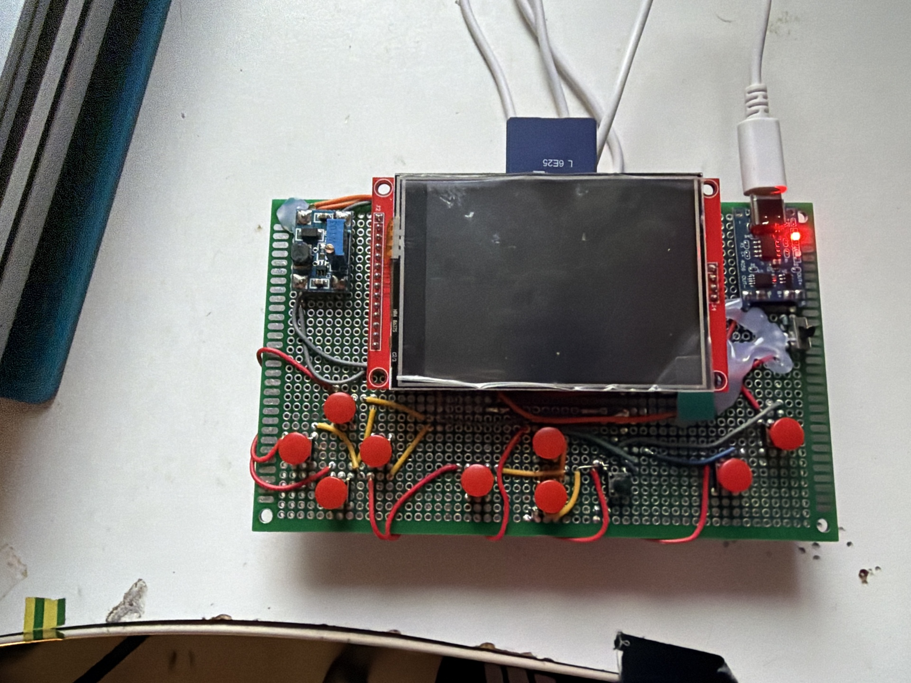

# Pocket Play

DIY handheld firmware for the **ESP32-S3**. Play retro games, listen to music, browse photos, and run your own small apps from microSD.

[Downloads](#downloads) · [Player guide](README-USER.md) · [Hardware and wiring](docs/HARDWARE.md) · [Build guide](BUILDING.md) · [App SDK](docs/APP_SDK.md)

The prototype uses a **150 × 90 mm** perfboard. [More prototype photos and enclosure dimensions](docs/HARDWARE.md#prototype-photos-and-dimensions)

## Downloads

Open the [latest release](https://github.com/Moutazbaaj/Pocket-Play/releases/latest) for release notes and downloads. Earlier versions are listed under [all releases](https://github.com/Moutazbaaj/Pocket-Play/releases).

| Download | Use it for |
| --- | --- |
| [PocketPlay.ino.bin](https://github.com/Moutazbaaj/Pocket-Play/releases/latest/download/PocketPlay.ino.bin) | Updating an existing Pocket Play over Wi-Fi or from microSD. |
| [PocketPlay-firmware.zip](https://github.com/Moutazbaaj/Pocket-Play/releases/latest/download/PocketPlay-firmware.zip) | A firmware bundle with the update image, USB first-install and recovery image, and instructions. |
| [PocketPlay-source.zip](https://github.com/Moutazbaaj/Pocket-Play/releases/latest/download/PocketPlay-source.zip) | Building the matching source in Arduino IDE. Extract it and open `PocketPlay/PocketPlay.ino`. |
| [SHA256SUMS.txt](https://github.com/Moutazbaaj/Pocket-Play/releases/latest/download/SHA256SUMS.txt) | Verifying the update image, firmware ZIP, or source ZIP. |

## Get started

The reference build uses an **ESP32-S3-WROOM-1-N16R8** with 16 MiB flash and 8 MiB PSRAM, a 320 × 240 ILI9341 display, an SPI microSD reader, and physical buttons. I²S audio and battery monitoring are optional. Confirm your wiring against the [pin map](docs/HARDWARE.md) before flashing.

| Your device | Installation |
| --- | --- |
| New board, a different partition layout, or a console that needs recovery | Install over **USB-to-UART** with the reference board profile. A release may provide a USB package for the reference wiring. [Build and flash](BUILDING.md#build-and-upload) · [USB recovery](BUILDING.md#package-firmware-for-usb-and-wi-fi) |
| Pocket Play already running with compatible OTA slots | Select the matching `.ino.bin` under **Firmware update** on the Wi-Fi Transfer page, or copy it to microSD and choose **Settings → About → Update Software**. [Wi-Fi update](README-USER.md#update-firmware-over-wi-fi) · [microSD update](README-USER.md#update-firmware-from-microsd) |

Use a FAT32 microSD card for games, media, and apps. Supply your own game files and Doom IWADs. [Card layout and formats](README-USER.md#set-up-the-microsd-card)

## Features

| Area | What Pocket Play supports |
| --- | --- |
| Cartridge games | Game Boy, Game Boy Color, Game Boy Advance, NES, Sega Master System, Game Gear, and Sega Genesis / Mega Drive |
| Launcher | Grid, Carousel, and List layouts, recent games, favorites, and BMP covers |
| Game options | Per-game profiles, display sizing, in-game pause, and three save-state slots |
| Doom | A dedicated launcher for Doom, Ultimate Doom, and Doom II with a compatible IWAD |
| Media | MP3 and PCM WAV with background playback, plus a still-image browser |
| Controls | Physical buttons, compatible USB HID keyboards and gamepads, and compatible Bluetooth LE controllers |
| Wi-Fi Transfer | A local browser page for file uploads, app installation, and firmware updates |
| Apps and tools | microSD apps, Tile Puzzle, Timing, Snake, clock and countdown, flashlight, light sleep, and battery diagnostics |

GBA and Genesis performance varies by title. Doom uses the handheld's physical controls and the reference 8 MiB PSRAM configuration. [Performance notes](docs/TECHNICAL_REFERENCE.md#measured-gba-performance) · [Doom setup](README-USER.md#play-doom)

Earlier interface previews show the three Home layouts and the Display settings. [Launcher layouts](docs/images/ui/launcher-layouts-preview.png) · [Display settings](docs/images/ui/display-settings-preview.png)

## Develop an app

The **Pocket Play SDK 1** provides a 320 × 224 canvas, button input, tones, and per-app saves. Write a Lua `.ppapp` package and install it from the Wi-Fi page or **Settings → About → Install Application**. Launch it from **Applications** on Home.

Try [RGB Mixer](test-applications/rgb-mixer.ppapp), [Unit Converter](test-applications/unit-converter.ppapp), or [Block Catch](test-applications/block-catch.ppapp). The SDK guide includes the package format, API reference, and a C++ example for a game built into the firmware. [App SDK](docs/APP_SDK.md)

## Build and contribute

Open `PocketPlay.ino` in Arduino IDE with **esp32 by Espressif Systems 3.3.2** and the **16M Flash (3MB APP/9.9MB FATFS)** partition scheme. The full guide lists the exact board options and USB and OTA binary formats. [Build options and firmware packaging](BUILDING.md)

Bug reports, hardware testing, emulator improvements, apps, and documentation contributions are welcome. Include the board, firmware version or build ID, and steps to reproduce when reporting an issue. [Contributing](CONTRIBUTING.md) · [Technical reference](docs/TECHNICAL_REFERENCE.md)

## Credits and licenses

Pocket Play is developed by Moutaz Baaj. Original Pocket Play code is licensed under **GPL-2.0-or-later**. The emulator cores, BIOS replacement, libraries, and other third-party work retain their respective licenses. [Project license](LICENSE) · [Third-party notices and credits](THIRD_PARTY_NOTICES.md) · [Moutaz Baaj on GitHub](https://github.com/Moutazbaaj)
